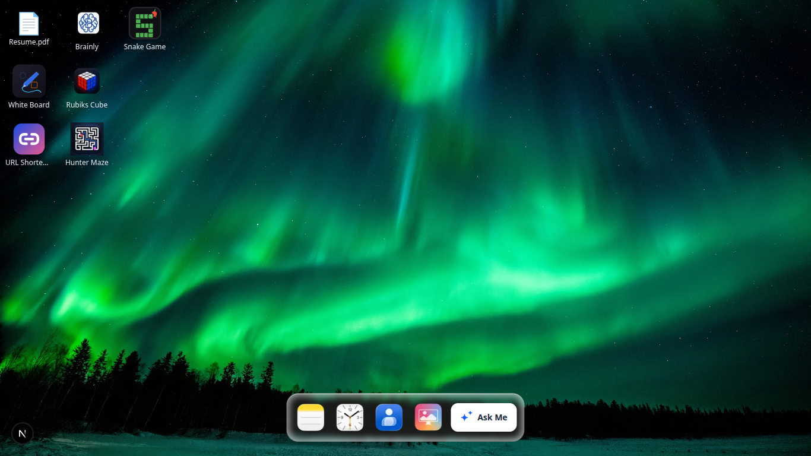

# 🖥️ Desktop-Style Portfolio

An interactive portfolio that looks and feels like an operating system. Visitors get a draggable desktop with icons, a floating dock, and resizable-style app windows. There's also an **Ask Me** assistant, powered by Google Gemini, that answers questions about me and my work.

Fully responsive: desktop, tablet and mobile each get their own grid and dock sizing.

> **Live demo:** `https://ai-portfolio-jet-seven.vercel.app/`

 

---

## ✨ Features

- **Desktop grid** – icons snap to a grid, can be dragged (single or multi-select), and a drag-select box lets you pick several at once.
- **Open items** – double-click (mouse) or tap (touch) to open the resume PDF or a project link.
- **Window manager** – draggable windows with minimize / maximize / close traffic-light controls, focus handling and z-index stacking.
- **Dock / taskbar** – macOS-style dock with open / minimized / focused indicators. It hides itself when an app is maximized.
- **Built-in apps** – Notes, Clock, Contact, Wallpaper and **Ask Me**.
- **Ask Me (AI)** – chat assistant grounded in my own portfolio context, with automatic model fallback when a Gemini model is overloaded.
- **Contact form** – server-side API route for messages.
- **Responsive** – three layout modes computed from the viewport:

  | Mode | Viewport | Grid |
  |---|---|---|
  | Desktop | ≥ 1024px | Fixed `TOTAL_COLS × TOTAL_ROWS` grid with reserved cells |
  | Tablet | 640–1023px | ~104px cells, columns/rows computed from size |
  | Mobile | < 640px | ~84px cells, columns/rows computed from size |

  Icons that no longer fit after a resize or rotation are automatically moved to the nearest free cell.

---

## 🧰 Tech Stack

- [Next.js](https://nextjs.org/) (App Router) + React + TypeScript
- [Tailwind CSS v4](https://tailwindcss.com/)
- [Google Gemini API](https://ai.google.dev/) via `@google/genai`

---

## 📁 Project Structure

```
.
├── app/
│   ├── api/
│   │   ├── chat/route.ts       # Ask Me → Gemini (with model fallback)
│   │   └── contact/route.ts    # Contact form handler
│   ├── favicon.ico
│   ├── globals.css
│   ├── layout.tsx
│   └── page.tsx                # Composes desktop, windows, dock
├── components/
│   ├── askMeApp.tsx            # AI chat window
│   ├── clockApp.tsx
│   ├── contactApp.tsx
│   ├── desktop.tsx             # Responsive icon grid + drag/select logic
│   ├── notesApp.tsx
│   ├── taskbar.tsx             # Responsive dock
│   ├── wallpaper.tsx
│   └── WindowFrame.tsx         # Draggable window chrome
├── lib/
│   ├── portfolioContext.ts     # System prompt / knowledge used by Ask Me
│   └── quickResponse.ts        # Instant canned replies
├── public/                     # Icons, wallpaper, resume PDF
└── types/                      # desktop.types.ts, window.types.ts
```

---

## 🚀 Getting Started

### Prerequisites

- Node.js 18.18+ (20+ recommended)
- A Gemini API key from [Google AI Studio](https://aistudio.google.com/apikey)

### Install

```bash
git clone https://github.com/<your-username>/<your-repo>.git
cd <your-repo>
npm install
```

### Environment variables

Create a `.env.local` file in the project root:

```env
GEMINI_API_KEY=your_gemini_api_key_here

# Add any variables your /api/contact route needs, e.g. email service keys
# CONTACT_...=
```

> ⚠️ Never commit `.env.local`. The Gemini key is only used server-side in `app/api/chat/route.ts`.

### Run

```bash
npm run dev      # development → http://localhost:3000
npm run build    # production build
npm run start    # serve the production build
```

---

## 🛠️ Customization

### Add or edit desktop icons

Icons live in `INITIAL_ITEMS` in `types/desktop.types.ts`. Each item has an `id`, `title`, `type` (`'pdf'` or `'project'`), an `icon` path from `/public`, a `gridPos` (`{ col, row }`) and `content` (`pdfPath` or `url`).

```ts
{
  id: 8,
  title: 'My Project',
  type: 'project',
  icon: '/icons/my-project.png',
  gridPos: { col: 0, row: 3 },
  content: { url: 'https://example.com' },
}
```

### Change the desktop grid size or reserved cells

Edit `TOTAL_COLS`, `TOTAL_ROWS` and `RESERVED_CELLS` in `types/desktop.types.ts`. This only affects the desktop (≥ 1024px) layout. Tablet and mobile sizes are set by `TARGET_CELL` and `DOCK_SPACE` at the top of `components/desktop.tsx`.

### Add a new app

1. Create the component in `components/` (e.g. `myApp.tsx`).
2. Register it in the app config used by `app/page.tsx` (id, title, icon, status).
3. It then appears in the dock and opens inside a `WindowFrame`.

### Teach Ask Me about yourself

Edit `lib/portfolioContext.ts`. It's passed as the Gemini `systemInstruction`, so anything written there becomes the assistant's knowledge about you (skills, projects, experience, links, tone of voice).

### Gemini model fallback

`app/api/chat/route.ts` tries each model in `FALLBACK_MODELS` in order. If one returns **503**, **404** or **429**, it moves to the next. Update the list as Google releases or retires models. Only the last 6 messages of history are sent to keep requests small and fast.

---

## 🔌 API Reference

### `POST /api/chat`

```json
{
  "message": "What projects have you built?",
  "history": [{ "role": "user", "parts": [{ "text": "Hi" }] }]
}
```

**200** → `{ "text": "..." }`
**400** → `{ "error": "Message is required." }`
**503** → `{ "error": "AI service is currently experiencing high demand..." }`

### `POST /api/contact`

Handles contact form submissions. See `app/api/contact/route.ts` for the expected payload.

---

## 📱 Responsive & Touch Notes

- Tap an icon on touch devices to open it; drag to move it. A 6px threshold separates taps from drags.
- Windows size themselves to the viewport on small screens and stay clear of the dock.
- The dock respects the iOS safe area (`env(safe-area-inset-bottom)`).
- Layout uses `h-dvh` so mobile browser toolbars don't cut off the desktop.

---

## ☁️ Deployment

Deploys well on [Vercel](https://vercel.com/):

1. Push the repo to GitHub.
2. Import it in Vercel.
3. Add `GEMINI_API_KEY` (and any contact-form variables) under **Project Settings → Environment Variables**.
4. Deploy.

---

## 📄 License

No License

---

## 📬 Contact

- Portfolio: `https://ai-portfolio-jet-seven.vercel.app/`
- LinkedIn: `www.linkedin.com/in/priyanshu-raj-ba0029338>`
- GitHub: `https://github.com/thepriyanshucodes`
- Email: `thepriyanshucodes@gmail.com`